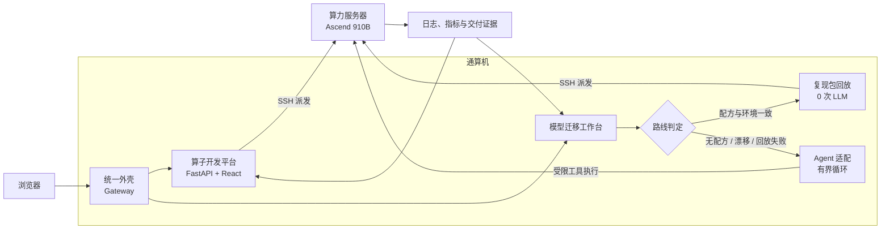

<p align="center">
  
</p>

<h1 align="center">算力调优工具链</h1>

<p align="center">
  统一模型迁移适配与算子开发，在一个 Web 入口完成任务编排、昇腾 NPU 真机验证与证据交付。
</p>

<p align="center">
  <a href="https://github.com/leafsys1/tk-operator-platform/tags"></a>
  <a href="operator/backend/pyproject.toml"></a>
  <a href="operator/web/package.json"></a>
  <a href="docs/03-verification.md"></a>
</p>

<p align="center">
  <a href="#快速开始">快速开始</a> ·
  <a href="#系统架构">系统架构</a> ·
  <a href="#验证与验收">验证与验收</a> ·
  <a href="#文档导航">文档导航</a> ·
  <a href="CHANGELOG.md">版本记录</a>
</p>

---

## 平台概览

算力调优工具链把两个原本独立的工作台收口到统一入口，并将 Web 服务与算力执行环境分离：通算机负责任务编排、状态展示和证据管理，算力服务器通过 SSH 接收任务并在昇腾 NPU 上执行验证。

| 组件 | 定位 | 关键能力 |
|---|---|---|
| **算子开发平台** | 面向 CANN 算子的开发与调优工作台 | 需求澄清、用例管理、编译、正确性测试、性能分析与交付归档 |
| **模型迁移工作台** | 面向模型 NPU 适配的迁移流水线 | 复现包回放、环境指纹比对、有界 Agent 介入、平台复验与适配沉淀 |
| **统一外壳** | 两个平台的单一 Web 入口 | 子路径反向代理、统一视觉、来源与 Host 限制、读写闸控制 |

### 核心设计

- **复现优先**：模型命中配方且环境指纹一致时直接回放，不调用 LLM。
- **有界介入**：无配方、环境漂移或回放失败时，Agent 在受限工具集和轮数上限内完成适配。
- **平台复验**：Agent 的自述不作为成功依据；模型必须由平台再次执行，并输出 `VERDICT=LOAD-OK`。
- **真机取证**：算子编译、正确性、性能与模型加载结果均保留可追溯证据。
- **可部署、可回退**：三个组件独立部署，仓库提供环境渲染、验收与按组件回退脚本。

## 系统架构



统一外壳是唯一对外监听的服务；两个业务平台默认只监听回环地址。完整的进程、路由与安全边界见[架构与边界](docs/01-architecture.md)。

## 快速开始

### 环境要求

- Ubuntu 22.04 或更高版本
- Python 3.12
- 可通过 SSH 访问算力服务器
- 算力服务器已安装 Ascend 驱动与 CANN，且 `npu-smi info` 可正常识别设备

### 部署

```bash
git clone https://github.com/leafsys1/tk-operator-platform.git
cd tk-operator-platform

cp deploy/site.env.example deploy/site.env
vi deploy/site.env

bash deploy/setup-operator.sh
bash deploy/setup-model-platform.sh
bash deploy/setup-shell.sh
bash deploy/verify.sh
```

部署参数统一写在 `deploy/site.env`。请按目标环境设置安装目录、端口、算力服务器连接信息和访问白名单，不要直接复用示例中的现场值。部署脚本按“算子平台 → 模型平台 → 统一外壳”的顺序执行；`verify.sh` 出现 `FAIL` 时不应交付。

详细前置条件、反向代理和数据迁移说明见[部署指南](docs/02-deploy.md)。

## 典型工作流

### 算子开发

1. 在工作台创建算子任务并确认规格与用例。
2. 通过受控执行链在算力服务器完成编译、冒烟、正确性和基准测试。
3. 汇总性能指标、运行日志与交付清单。
4. 生成带校验信息的交付包，保留全过程证据。

### 模型迁移

1. 解析模型并匹配历史复现包。
2. 比较环境指纹，选择 `replay` 或 `agent` 路线。
3. 在 NPU 环境完成加载与前向验证；失败时读取证据并受限修正入口。
4. 由平台独立复验成功结果，归档入口、配方、环境指纹和审计记录。

Agent 的工具边界、成功判据和实测案例见[Agent 介入层设计](docs/06-agent-design.md)。

## 验证与验收

### 离线回归

```bash
# 模型迁移：路线判定、动作解析、沙箱边界与循环上限
python3 -m unittest discover -s model-platform/tests -v

# 统一外壳：路由、安全边界、缓存与视觉契约
python3 -m pytest shell/tests -q

# 部署模板与脚本自检（在目标 Ubuntu 环境执行）
bash deploy/selftest-render.sh
bash deploy/selftest-run.sh
```

### 部署验收

```bash
bash deploy/verify.sh           # 只读验收
bash deploy/verify.sh --write   # 增加写链路验收
bash deploy/verify.sh --gpu     # 增加设备状态检查
```

`verify.sh` 会检查进程、端口、回环监听、统一入口、缓存头、两侧 API 和端点状态，并以 `PASS / FAIL / SKIP` 汇总。真机验证记录及未覆盖项见[验证证据](docs/03-verification.md)。

## 仓库结构

| 路径 | 内容 |
|---|---|
| [`shell/`](shell/) | 统一入口、反向代理、品牌资源与网关测试 |
| [`operator/`](operator/) | 算子平台的 FastAPI 后端、React 前端和算子工作区 |
| [`model-platform/`](model-platform/) | 模型迁移服务、静态页面、Agent 桥接层与离线测试 |
| [`compute-side/`](compute-side/) | 算力服务器侧的探针、兼容层与受限执行脚本 |
| [`deploy/`](deploy/) | 环境模板、安装、验收、自检和回退脚本 |
| [`docs/`](docs/) | 架构、部署、验证、问题清单、运维和 Agent 设计文档 |
| [`tools/`](tools/) | 真机验证与证据辅助工具 |

## 安全边界

> [!WARNING]
> 当前交付形态面向受控内网环境，不应直接暴露到公网。仓库基线中的网关服务单元默认关闭认证、允许写操作，并使用较宽的 Host 配置。正式部署前必须启用认证、收紧 `ALLOWED_CIDRS` 与 `ALLOWED_HOSTS`，并按需开启两侧只读闸。

模型名会进入远端执行链，现阶段只应接收可信输入。完整风险、临时规避方式和待修项见[已知问题](docs/04-known-issues.md)。

## 文档导航

| 文档 | 用途 |
|---|---|
| [架构与边界](docs/01-architecture.md) | 组件关系、进程、路由、执行链与资源隔离 |
| [部署指南](docs/02-deploy.md) | 环境配置、安装顺序、反向代理与迁移 |
| [验证证据](docs/03-verification.md) | 已验证结果、成功判据和未覆盖范围 |
| [已知问题](docs/04-known-issues.md) | 当前风险、影响、规避方式与修复状态 |
| [运维与回退](docs/05-operations.md) | 日常排查、升级、备份和组件回退 |
| [Agent 介入层设计](docs/06-agent-design.md) | 路线判定、工具白名单、复验与审计机制 |
| [变更记录](CHANGELOG.md) | 版本行为变化与回退点 |
| [项目账本](LEDGER.md) | 仓库基线、交付事实与历史决策 |

## 版本与回退

当前稳定标签为 [`v0.1.6`](https://github.com/leafsys1/tk-operator-platform/releases/tag/v0.1.6)。升级前应先完成离线回归，部署后必须运行 `deploy/verify.sh`；未通过验收时可使用 `deploy/rollback.sh` 按组件回退。数据库与运行数据不在脚本的自动回退范围内，变更前请按[运维文档](docs/05-operations.md)完成备份。
