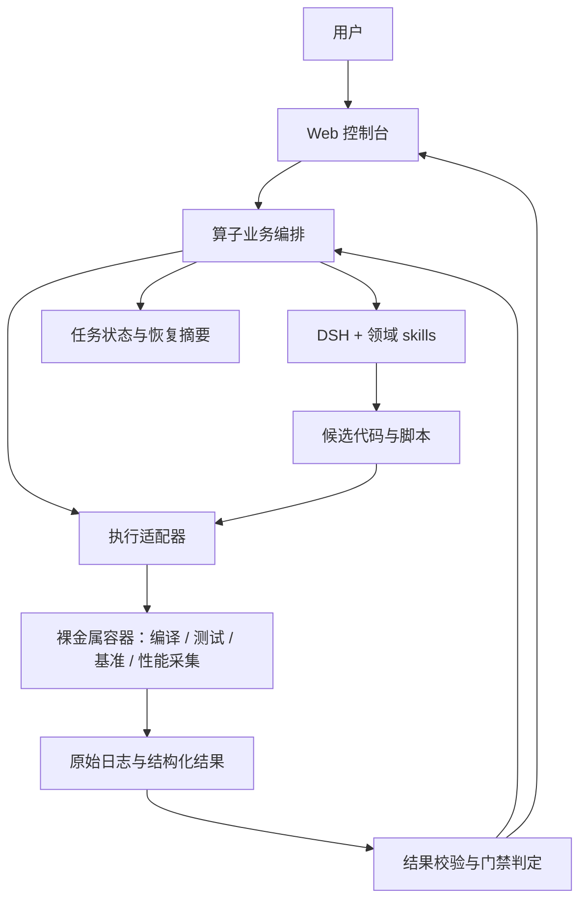
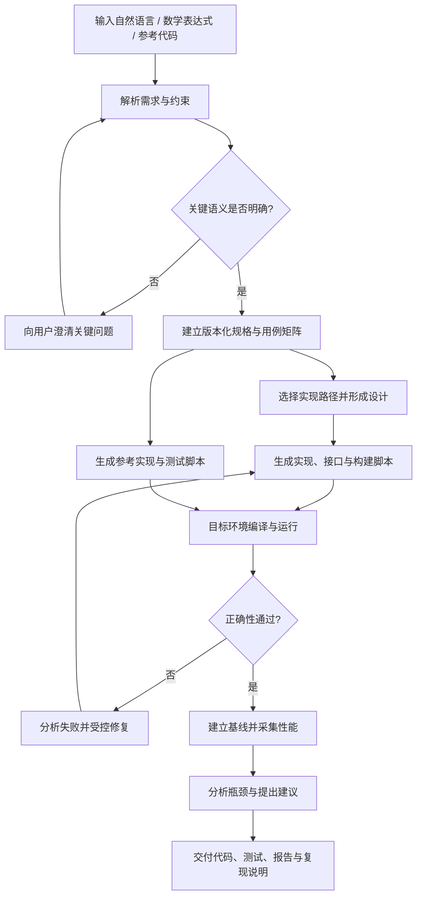

# 算子开发智能体优化方案 v2.0

版本：v2.0 · 优化建议稿  
日期：2026-10-14  
依据：用户提供的能力目标与《PLAN-web-console.md》v1.0  
定位：补齐智能体业务流程、执行契约和验收标准，沿用原方案的控制台与远端执行路线。

> 本文是一份建议方案。“拟采用”“应支持”表示设计要求，不表示已经实现。原方案记载的版本、兼容性和实测结果属于来源记录，本文未重新验证。产品验收以实际算子执行证据为准。

## 1. 建设目标与范围

### 1.1 建设目标

建设算子开发智能体，支持用户通过自然语言、数学表达式或参考代码描述算子功能，结合输入输出形状、数据类型和目标硬件信息，辅助生成算子实现代码、调用接口、构建脚本和测试脚本。

智能体应生成常规、边界及异常输入测试用例，运行候选实现与参考实现，检查输出形状、数据类型和数值误差，形成可追溯的正确性测试报告。

正确性通过后，智能体调用性能分析工具，采集执行耗时、数据搬运、存储使用及计算单元负载等信息，分析可能的性能瓶颈，并给出数据分块、并行计算、存储复用或算子融合等优化建议。

首版完成“需求输入 → 实现生成 → 真机验证 → 性能分析 → 结果交付”的完整流程。自动修改代码并反复调优作为可选扩展，首版不以自动获得性能提升为必需验收条件。

### 1.2 首版范围

| 项目 | 首版范围 |
|---|---|
| 硬件 | 延续原方案，先面向昇腾 NPU；具体芯片与软件环境在任务中声明 |
| 需求输入 | 自然语言、数学表达式、参考代码；统一转换为结构化规格 |
| 实现路径 | 从已接入、已验证的 CANNBot 能力中选择适用路径；首版先跑通一种实现路径 |
| 代码产物 | 算子实现、调用接口、构建/运行脚本、使用示例 |
| 正确性 | 常规、边界、异常输入；与独立参考实现对比 |
| 性能 | 算子层基准测试、性能采集、瓶颈分析和建议 |
| 交互 | Web 控制台管理任务、资源、执行过程与报告；复用 DSH 对话能力 |
| 执行 | 控制台与 DSH 在独立机器；裸金属容器负责算子编译、测试与性能采集 |
| 使用方式 | 首版单人，任务并发默认 1；性能执行按设备进行互斥 |

后续扩展可包括更多实现框架、其他硬件后端、多用户、跨机调度、模型级分析和受控自动调优。不同硬件通过环境、构建、运行和性能采集适配器接入。

## 2. 总体架构

整体分为五层，Web 控制台与智能体业务编排分别承担明确职责。

| 层次 | 职责 | 实现方式 |
|---|---|---|
| 交互层 | 需求提交、规格查看、对话、任务进度、报告和产物下载 | Web 控制台 + DSH 对话入口 |
| 业务编排层 | 规格版本、阶段推进、能力路由、结果校验、受控修复和任务恢复 | 后端状态机与结构化契约 |
| 智能体能力层 | 需求理解、方案设计、代码生成、错误分析和优化建议 | DSH + 按阶段加载的 CANNBot skills |
| 执行层 | 工作区快照、远端同步、容器执行、产物回读、超时与取消 | 本地执行适配器 + SSH/rsync + 容器 |
| 证据与存储层 | 规格、用例、代码版本、执行记录、原始数据和结构化报告 | 数据库 + 文件产物 + 会话日志 |



沿用 DSH 作为通用智能体运行时，复用领域 skills。新增的业务编排层负责规定每个阶段的输入、输出、通过条件和失败处理，确保会话结果能够转化为可验证的算子开发结果。

不要求按阶段拆成多个独立智能体。首版采用一个主控执行流程即可，后续需要并行开发或独立审查时再扩展。

## 3. 智能体业务流程

### 3.1 主流程



### 3.2 各步骤的输入、输出与判定

| 步骤 | 输入 | 必需输出 | 通过条件 |
|---|---|---|---|
| 需求解析 | 用户描述、数学式或参考代码 | 结构化规格、待澄清项、显式假设 | 影响语义与实现的关键问题已解决 |
| 用例规划 | 规格与支持范围 | 常规/边界/异常用例矩阵 | 覆盖要求有对应用例或明确的范围说明 |
| 方案设计 | 规格、硬件环境、相似实现 | 实现路径、算法、分块与存储设计 | 设计符合规格，环境支持所选路径 |
| 代码生成 | 设计与能力模板 | kernel、调用接口、构建与运行脚本 | 产物可被统一执行入口调用 |
| 构建验证 | 候选源码与目标环境 | 构建日志、构建结果、实现检查结果 | 构建通过，必要的实现专项检查通过 |
| 正确性验证 | 候选实现、参考实现、测试集 | 逐用例结果与正确性报告 | 所有必需用例符合任务判据 |
| 性能测量 | 正确性通过的代码与有效用例 | 基准样本、性能原始数据与指标 | 测量范围明确、数据有效、环境可追溯 |
| 分析与建议 | 性能指标、原始证据、实现设计 | 瓶颈假设、建议、适用范围与验证方式 | 建议引用证据，区分观测、推断和待验证事项 |
| 交付 | 已通过验证的代码和报告 | 交付包、接口说明、复现步骤 | 交付版本与验收版本一致，必需产物齐备 |

### 3.3 失败与修复

失败分类至少包括：规格不明确、生成产物不完整、构建失败、正确性失败、测量无效、环境失败和超时。

构建或正确性失败后，主控提取错误摘要、失败用例与最小必要证据，要求智能体进行有边界的修复，再生成新的代码版本与执行记录。历史失败记录保留。

修复轮次和总执行预算可配置，达到上限后输出失败原因、已尝试方向及下一步建议。基础设施失败不默认自动重试，不把环境问题当成算子实现错误。

需求发生实质变化时生成新的规格版本，并重新判断哪些既有测试证据仍然有效。

## 4. 需求解析与结构化规格

### 4.1 规格字段

规格作为代码生成、测试生成和验收的共同依据，至少包含以下内容：

| 类别 | 字段 |
|---|---|
| 来源 | 原始描述、输入方式、参考代码路径及摘要 |
| 语义 | 算子名称、数学定义、参数、属性、广播与归约规则 |
| 输入输出 | 数量、名称、shape、dtype、layout、stride/连续性要求、输出推导规则 |
| 支持范围 | 动态维度范围、合法参数集合、支持和不支持的组合 |
| 特殊行为 | 空输入、NaN/Inf、非法 shape/dtype/参数等行为 |
| 环境 | 目标芯片、框架、编译与运行环境要求 |
| 正确性 | 参考实现、容差策略、特殊值比较规则、异常输入预期 |
| 性能 | 测量范围、代表性用例、基线、可选性能目标 |
| 交付 | 调用形式、接口约束、交付产物和复现要求 |
| 版本 | 规格版本、假设、未确定项、变更记录 |

缺失事实标记为 `UNKNOWN`。关键语义、支持范围或硬件约束未确定时，不进入依赖这些信息的代码生成。可使用合理默认值的事项明确记录，不要求用户逐项确认所有工程参数。

### 4.2 规格示例

以下为说明结构的示例，不代表所有任务采用相同 dtype、容差或执行路径。

```yaml
spec_version: 1
operator: elementwise_add
source:
  input_form: natural_language
  description: 对两个同形状张量逐元素相加
semantics:
  formula: C[i] = A[i] + B[i]
  broadcasting: false
inputs:
  - name: A
    shape: [N]
    dtype: float32
    layout: ND
    contiguous: true
  - name: B
    shape: [N]
    dtype: float32
    layout: ND
    contiguous: true
outputs:
  - name: C
    shape: [N]
    dtype: float32
constraints:
  N_range: [1, 1048576]
  invalid_shape_behavior: reject
  unsupported_dtype_behavior: reject
target:
  hardware: Ascend_910B
  implementation_path: Ascend_C
reference:
  implementation: reference.py
validation:
  tolerance_profile: operator_specific_float32
  required_case_groups: [normal, boundary, invalid]
performance:
  scope: operator
  baseline: UNKNOWN
  target_latency_us: UNKNOWN
delivery:
  required: [kernel, invocation, build_script, test_script, reports]
```

## 5. 方案设计与代码生成

代码生成前先形成简明设计，说明算法、实现路径、核间划分、分块、数据搬运、缓冲区和接口接入方式。实现专项知识按需加载，避免把全部 skills 同时加入上下文。

根据所选实现路径，生成以下产物：

1. 算子实现代码及必要的 host/tiling 代码。
2. 用户可调用的接口或注册接入代码。
3. 构建脚本、运行入口和依赖说明。
4. 参考实现、测试用例与测试脚本。
5. 基准测试脚本和性能采集入口。
6. 最小调用示例和接口文档。

参考实现优先复用可信的既有实现；确需生成时，单独审查其数学语义和边界行为。候选实现与参考实现保持独立，避免使用同一计算路径相互验证。

候选代码、测试脚本和参考实现分别记录版本或哈希。调整测试判据、用例或参考实现时保留变更原因，避免修复过程改变验收依据而未被记录。

## 6. 测试生成与正确性验证

### 6.1 用例矩阵

用例按算子语义和实际支持范围生成。每个用例记录 shape、dtype、layout、参数、输入生成方式、随机种子、分组和预期行为。

| 用例组 | 主要覆盖内容 |
|---|---|
| 常规输入 | 典型 shape、支持的 dtype/属性组合、代表性数据分布 |
| 边界输入 | 最小/最大合法尺寸、非对齐尺寸、尾块、特殊布局；空输入按规格处理 |
| 数值边界 | 零值、极值、正负混合及适用的 NaN/Inf 情况 |
| 异常输入 | 非法 shape、类型不支持、参数越界、约束不满足等 |
| 回归输入 | 已发现问题的最小复现用例和交付必须保护的用例 |

NaN/Inf 和空输入是否有效，由算子规格决定。不同 shape/dtype/布局的覆盖不能只按元素总数合并。

### 6.2 验证项目

正确性验证包含：

- 输出数量、形状和数据类型是否符合规格。
- 数值是否满足所选判据；误差统计由测试程序计算。
- 广播、归约、参数和特殊值行为是否符合约定。
- 非法输入是否表现为规定的拒绝或其他明确行为。
- 实际执行的是否为候选算子路径，有无未声明的回退。

可沿用原方案中的精度标准能力作为默认档，同时支持项目自定义档。实际判据按算子语义、dtype、计算方式及归约长度确定，记录标准版本、参数和适用范围。

异常输入验证以接口契约为准：要求错误码时检查错误码，要求异常类别时检查类别；只有接口明确要求时才检查完整错误文本。仅“不崩溃”不能证明规定的异常处理行为已实现。

### 6.3 报告结构与判定

正确性报告至少包含：代码/规格/测试集版本、环境、参考实现版本、判据、用例总数、逐例状态、形状/dtype 检查、误差统计、失败详情和复现命令。

结果状态包括 `PASS`、`FAIL`、`ERROR`、`INVALID`、`NOT_RUN`。合法的跳过必须记录理由；必需用例未执行不能计入通过。

通过条件：所有必需用例实际执行且达标，报告来源与当前候选版本一致。报告缺失、解析失败或证据版本不匹配，均不满足正确性门禁。

## 7. 性能采集、瓶颈分析与建议

### 7.1 测量与采集

首版只采算子层性能。沿用原方案拟采用的 `msopprof` / `msprof`，具体可用命令、数据格式和指标支持在目标环境中验证，并通过采集适配器屏蔽差异。

| 指标类别 | 计划采集内容 | 使用目的 |
|---|---|---|
| 执行耗时 | kernel 或算子总耗时、原始样本和聚合值 | 建立基线，比较改动效果 |
| 数据搬运 | 可获取的搬运量、搬运耗时、带宽或等待信息 | 分析访存与计算重叠问题 |
| 存储使用 | 可获取的设备内存与片上存储信息 | 分析缓冲区、复用和资源限制 |
| 计算单元负载 | 可获取的计算单元活动、负载或忙闲信息 | 分析并行划分、流水和负载不均 |

每项指标标记 `measured`、`estimated`、`unsupported` 或 `failed`，并记录来源。估算值附带假设，不作为实测值展示。必需指标采集失败时，任务标记为性能分析未完成；环境不支持目标指标时，明确披露能力缺口。

基准测试与 Profiling 分开执行，避免混用不同测量范围或采集条件下的耗时。

### 7.2 基线与可比性

基线按算子和用例选择，可为官方对应实现、既有可信实现或上一版已验证实现。原方案中的 Matmul 基线仅用于语义、dtype 和支持范围匹配的任务。

性能记录固定以下条件：用例与输入、代码版本、硬件/设备、软件栈、镜像 digest、预热次数、重复次数、同步方式、测量范围和聚合方法。

保存原始样本和波动信息。性能提升需有同条件对比，并超过测量不确定性；证据不足时输出“无法确认提升”。理论上界或耗时下界可辅助分析，但必须说明模型、假设和适用范围。

### 7.3 瓶颈分析

分析按“观测 → 竞争假设 → 建议 → 验证”组织。低计算负载、较长搬运时间等现象用于建立假设，不能直接等同于确定的瓶颈成因。

| 建议方向 | 需要结合的证据与约束 |
|---|---|
| 数据分块 | shape、尾块、搬运开销、片上存储容量和复用机会 |
| 并行计算 | 核间工作量、计算单元负载、启动/同步开销和可并行维度 |
| 存储复用 | 重复读取、缓冲区生命周期、资源占用和依赖关系 |
| 流水重叠 | 搬运与计算时间、等待现象、同步关系和缓冲区安排 |
| 算子融合 | 相邻算子语义、数据流、中间结果搬运和接口兼容性 |

只有单算子信息、缺少相邻计算上下文时，融合建议应注明需要补充哪些信息。

每条建议包含：

```yaml
recommendation:
  id: R1
  affected_cases: [case_ids]
  observed_evidence: [metric_ids, artifact_paths]
  bottleneck_hypothesis: 可能的瓶颈机制
  confidence: low_or_medium_or_high
  proposed_change: 具体修改方向
  expected_observation: 修改后应出现的变化
  constraints_and_risks: 正确性、资源和回归约束
  validation_method: 同条件基准与必要的再次采集
  status: proposed_or_validated_or_rejected_or_inconclusive
```

### 7.4 可选自动调优

启用自动调优后，每轮围绕一个有边界的机制假设开展修改，记录固定条件、可改变量、受影响用例、接受/否定条件和执行预算。

修改后重新做正确性与同条件性能对比。主控作出接受、否定、证据不足或转向的结论，保留失败证据。满足目标、预算耗尽、剩余收益不明确或候选方向耗尽时停止，并说明依据。

## 8. 数据模型与证据管理

### 8.1 核心对象

采用 `Project → Task → Loop → Run → Artifact` 管理开发状态，同时独立记录会话与智能体调用。

| 对象 | 含义与关键字段 |
|---|---|
| Project | 工作区、默认主机/镜像、运行时配置；主机与镜像是默认配置，不固定项目身份 |
| Task | 算子目标、当前规格版本、阶段、当前认知、交付条件与下一步 |
| SpecVersion | 原始输入、结构化规格、假设、变更原因和哈希 |
| Case / SuiteVersion | shape/dtype/layout/属性、输入生成规则、种子、覆盖组、预期结果和测试集版本 |
| Loop | 一轮设计、修复、诊断或优化方向；范围、假设、判定条件和结论 |
| AgentJob | 一次智能体调用；任务/轮次、会话、输入摘要、产物、运行状态和 usage |
| Run | 一次实际构建、测试、基准或采集；代码/用例/环境/命令/结果 |
| Artifact | 产物类型、路径、大小、哈希、来源 Run 和报告格式版本 |
| CaseResult / Metric | 逐用例结果、指标值、单位、采集状态和证据引用 |
| Conversation | DSH 会话与项目/任务关联；可关联多个 AgentJob |
| Host / HostImage | 设备信息、镜像清单、开发环境配方与探测记录 |
| StageEvent / Recommendation | 阶段变更原因；建议及其证据、验证状态 |

首版可通过 JSON 字段和结果文件简化实现，不要求立即建立全部独立表。但代码、规格、测试集和环境的版本关联必须保留。

一轮智能体调用可以产生多个真实执行 Run。批量测试可归属同一 Run，但逐用例结果仍应有稳定的 Case ID。业务通过状态不由会话退出码直接决定。

### 8.2 执行清单

每个真实执行 Run 保存：

- Task/Loop/AgentJob 关联及执行类型。
- 规格版本、代码版本或源码快照哈希。
- 测试集、参考实现、判据版本和用例 ID。
- 主机、设备、镜像 digest、环境配方快照及工具版本。
- 执行命令、工作目录、开始/结束时间、退出码。
- 原始日志、结果文件及各产物哈希。

明确命令执行状态与业务结果：命令退出成功后，仍需校验报告有效性和测试结果；进程异常退出时保留部分产物，但不计为验收通过。

### 8.3 数据来源与恢复

DSH 会话日志用于保存对话和工具调用过程。测试程序、基准程序与采集工具的原始产物用于支撑业务结果；结构化报告由解析器和校验器生成，智能体负责解释结果。

数据库保存索引、状态、关键结果与版本关系；大日志、源码快照和性能原始文件保存在产物目录。SSE 事件带序号，可从持久化日志补读；服务重启后核对执行状态，不能仅依赖内存事件判断任务是否完成。

任务恢复时优先读取紧凑摘要：目标、当前规格、活动 Loop、保护用例、按用例基线、已接受结论、最近失败原因和下一步动作。完整历史通过证据索引按需读取。

## 9. 阶段与门禁

外部继续使用原方案的四阶段，内部通过 Loop 和 Run 管理细分动作。

| 阶段 | 门禁要求 | 主要产物 |
|---|---|---|
| 需求与设计 | 关键语义明确；规格、用例规划、环境要求和实现路径完整 | 规格、用例矩阵、设计 |
| 开发 | 当前版本真实编译通过；必需代码、接口和脚本完整；专项检查通过 | 源码、接口、构建日志、检查结果 |
| 验收 | 必需正确性用例通过；有效性能报告与证据引用齐备；瓶颈分析和建议完成 | 正确性报告、性能数据、分析与建议 |
| 交付 | 交付代码与验收版本一致；文档、脚本和复现材料齐备 | 交付包、接口文档、复现说明 |

门禁判定以有效业务结果为依据，同时检查产物完整性和版本一致性。缺项、失败和证据失效均展示具体原因。

如果任务另有明确性能目标，验收还应检查目标是否达到。没有性能提升目标时，以测量和分析完成作为性能部分的要求，不能擅自增加“必须更快”的交付条件。

## 10. 远端执行与技术实现

### 10.1 工作区与远端执行

任务维护持续开发的本地工作区；每次真实执行生成确定的源码快照。快照同步至独立远端目录，在指定容器环境中执行并回读结果。

统一执行入口支持 `build`、`test`、`benchmark`、`profile` 四种动作：

1. 检查任务配置与本次动作的必要环境条件。
2. 固定源码、规格、测试集及环境配方版本。
3. 同步源码快照到远端 Run 目录。
4. 按动作执行编译、测试或性能采集。
5. 回读日志、原始数据与结构化结果。
6. 生成 manifest，登记 Run，调用报告校验与门禁判定。

延续原方案的 `nm_test.sh` 路线，先作为执行适配器后端使用；其参数和返回结果应形成明确契约。主机、镜像、设备与环境配方从任务配置注入，减少手工复制和结果漏登记。

镜像登记可继续采用“标记 + 配方”。开始真实执行前检查当前动作必需的环境条件，失败时报告环境问题。设备映射、驱动挂载、工具可用性等根据目标环境验证后固化到配方。

取消或超时应传递至远端容器/进程，记录清理结果，避免只终止本地会话而远端仍运行。远端目录按保留策略清理，产物回读并校验成功后才能删除必需证据。

### 10.2 技术栈

| 层次 | 沿用选型 | 本版新增要求 |
|---|---|---|
| 后端 | Python + FastAPI + Pydantic | 阶段编排、报告校验、执行适配器、恢复与失败分类 |
| 数据 | SQLAlchemy + Alembic；首版 SQLite | 版本关系、逐用例结果、指标和建议证据 |
| 前端 | React + TypeScript + Vite + Tailwind + shadcn/ui | 围绕算子开发主流程组织任务详情 |
| 实时 | SSE | 事件序号、补读、重连和最终状态核对 |
| 图表 | ECharts | 同用例比较、误差分布、指标来源和缺失状态 |
| 运行时 | DSH CLI | 使用已验证版本；独立记录调用与业务结果 |
| 领域能力 | CANNBot skills | 提前接入，固定版本，按阶段选择能力 |
| 执行 | SSH + rsync + 容器 | 源码快照、环境快照、超时/取消、统一结果契约 |

原方案记载的 DSH CLI `0.2.0-rc.2` 和 CANNBot commit 可作为初始复核候选。实施时记录实际采用版本及验证结果，升级后重新做集成冒烟。对话反代仍需完成 WebSocket 等未完成项的部署验证。

## 11. Web 控制台设计

首版优先实现任务列表、任务详情、资源配置及对话入口。任务详情围绕用户判断“下一步做什么、结果是否可信”组织。

| 页面区域 | 主要内容 |
|---|---|
| 需求与规格 | 原始需求、结构化规格、关键假设、未确定项和版本变更 |
| 实现与接口 | 设计、源码/diff、调用方式、构建结果 |
| 测试与正确性 | 用例覆盖、逐例结果、误差、失败输入和复现命令 |
| 性能与建议 | 测量范围、基线、指标、证据、瓶颈假设和建议 |
| 执行记录 | Loop、AgentJob、Run 关联；命令、环境、日志和消耗 |
| 交付 | 验收状态、产物清单、下载和复现说明 |

保留原方案的亮暗主题与设计变量体系。阶段看板、独立测试管理、API 管理和消耗分析可以在核心流程跑通后完善。

## 12. 实施路线与 MVP 验收

### 12.1 按完整流程推进

| 阶段 | 交付内容 | 验收条件 |
|---|---|---|
| M0 契约与环境 | 一个样例算子的规格、结果格式、运行时/skills 接入和目标环境 | 已知正确样例可在目标容器编译与运行 |
| M1 生成与正确性 | 需求解析、实现/接口/测试生成、执行与受控修复 | 从用户输入到真实正确性报告完整跑通 |
| M2 性能与分析 | 基准、采集、指标解析、瓶颈分析和建议 | 报告包含可追溯数据及有证据的建议 |
| M3 控制台与交付 | 任务详情、过程展示、门禁、产物下载和复现说明 | 用户可在控制台完成一次真实算子任务 |
| M4 使用完善 | 会话关联、看板、测试管理、API/消耗、恢复和保留策略 | 日常开发可持续使用，失败和中断可追踪 |
| M5 可选扩展 | 自动调优、更多实现路径/硬件、多用户和调度 | 分别定义目标与验收，不阻塞首版 |

优先选择语义明确、参考可信、环境可运行的算子打通完整流程。原方案的 complex64 matmul 可作为后续代表性验证任务；如果环境已成熟，也可选作首条流程，但应先确认接口和基线支持范围。

### 12.2 MVP 验收清单

首个 MVP 必须提供以下真实证据：

1. 三种需求输入方式均能形成结构化规格；至少一种输入方式完成全流程演示。
2. 缺失关键语义时能够提出具体澄清问题，假设有记录。
3. 生成算子实现、调用接口、构建脚本、测试脚本和使用示例。
4. 在声明的目标硬件与环境中真实编译、运行候选实现。
5. 常规、边界及异常用例有覆盖，报告包含形状、dtype、数值误差及异常行为判定。
6. 能保留并展示失败用例、错误原因和修复后的新执行记录。
7. 采集执行耗时、数据搬运、存储使用和计算单元负载等目标指标；未支持项明确标记，不能按已采集验收。
8. 至少一条优化建议引用性能证据，说明适用范围和验证方法；建议不要求已获得加速。
9. 报告和交付代码可通过版本、环境、命令与产物哈希相互对应。
10. 从独立工作目录按复现说明运行，能够重现声明的正确性结论并再次采集性能。

自然语言解释、会话退出成功、页面展示正常和报告文件存在，都应与上述执行证据结合验收。

### 12.3 已有验证的使用方式

按原方案记录，已有验证主要覆盖 DSH 事件流、会话恢复、skills 识别、文件同步和部分对话反代。容器执行链路仍有未验证步骤，因此这些记录可作为集成基础，完整 MVP 还需要补充真实算子的编译、正确性、性能和交付验证。

## 13. 关键决策与原方案调整

| 原方案内容 | 本版建议 |
|---|---|
| 以控制台、资源和会话集成为主要路线 | 增加算子业务编排主线，以真实算子结果验收 |
| CANNBot 能力接入位于 P5 | 在 M0/M1 接入，作为首条流程的组成部分 |
| 规格门禁主要检查 shape/dtype/硬件 | 补充语义、布局、支持范围、参考实现和验证契约 |
| Run 同时承担会话与执行含义 | 区分 AgentJob 与真实执行 Run，加入 Loop 和版本关联 |
| 门禁表述为产物齐备 | 检查结果有效、业务达标、版本一致和产物完整 |
| 异常输入可降级为不崩溃 | 按规格定义的预期行为验证 |
| 默认使用 Matmul 基线 | 按算子与用例选择语义匹配的可信基线 |
| 以图表和性能对比展示结果 | 增加指标来源、瓶颈假设、建议和验证方式 |
| 每 Run 一次性工作区 | 明确持续开发工作区、执行快照和已接受代码版本的关系 |
| 会话 JSONL 作为全量真相源 | 对话过程与业务执行证据分别保留并建立关联 |

实施前需要明确：首个样例算子、首条实现路径、目标芯片与镜像、参考实现与判据、工具指标支持范围，以及修复预算和产物保留策略。

涉及运行时、采集工具和领域 assets 的版本、兼容性与许可，实施时依据官方材料复核并记录；本文不将原方案的来源标注提升为新的核验结论。

## 附录：建议交付目录

```text
delivery/
├── README.md                 # 调用方式、范围与复现步骤
├── spec.json                 # 验收规格
├── design.md                 # 实现设计
├── src/                      # 算子与接口代码
├── examples/                 # 最小调用示例
├── scripts/                  # 构建、测试、基准和采集入口
├── tests/                    # 用例集与参考实现
├── reports/
│   ├── correctness.json      # 机器可读正确性结果
│   ├── correctness.md        # 正确性报告
│   ├── performance.json      # 指标与测量信息
│   ├── performance.md        # 性能报告
│   └── recommendations.md    # 瓶颈假设与建议
├── evidence/                 # 原始样本、日志与采集数据
└── manifest.json             # 版本、环境、来源和产物哈希
```

内部可使用补丁和执行包组织交付；对用户提供统一入口，保证代码、接口、测试、报告和复现材料可一并获取。
